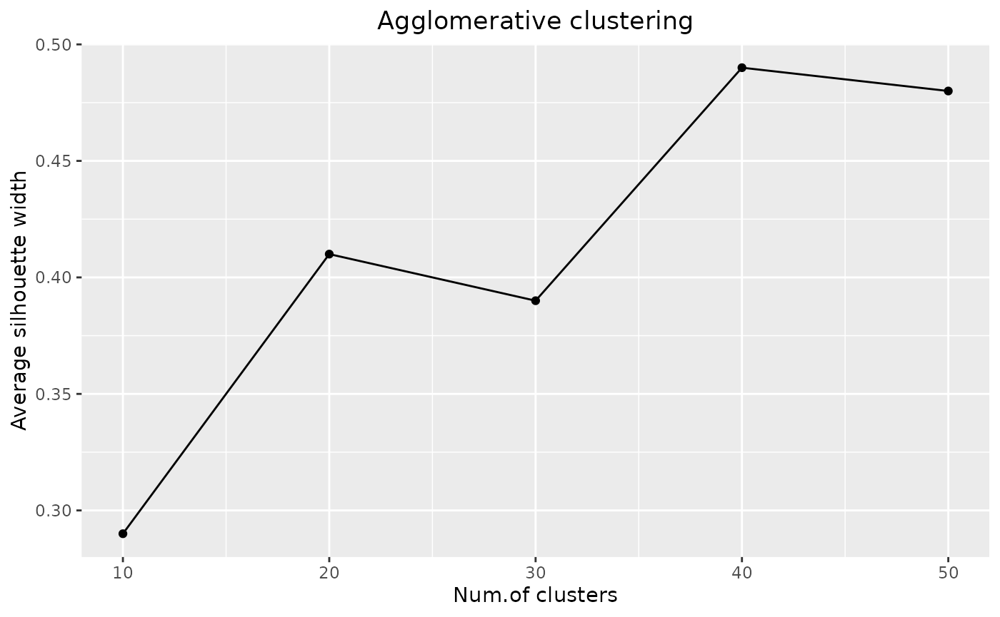

# Get started

``` r

library(strainselect)
```

## Overview

{strainselect} helps choosing which bacterial strains to sequence from a
collection described by metadata (sampling context, matrix, region,
sector, year…). It offers two complementary methods:

- the **clustering method**
  ([`assess_gower()`](https://lguillier.github.io/strainselect_package/reference/assess_gower.md),
  [`cstats_table()`](https://lguillier.github.io/strainselect_package/reference/cstats_table.md),
  [`select_silhouette()`](https://lguillier.github.io/strainselect_package/reference/select_silhouette.md))
  is suited when the number of strains that can be sequenced is limited.
  Strains are grouped into *k* clusters of similar strains and the best
  clustered strain of each cluster is selected, so that the selected
  strains are as different as possible from each other;
- the **profile method**
  ([`prepare_upset()`](https://lguillier.github.io/strainselect_package/reference/prepare_upset.md),
  [`define_profiles()`](https://lguillier.github.io/strainselect_package/reference/define_profiles.md),
  [`select_profiles()`](https://lguillier.github.io/strainselect_package/reference/select_profiles.md))
  is suited when the number of strains to sequence is not limited.
  Strains sharing exactly the same metadata are grouped and one strain
  per group is selected, so that every distinct profile — including
  unique strains — is represented.

Both methods start with
[`prepare_input()`](https://lguillier.github.io/strainselect_package/reference/prepare_input.md),
which cleans the raw table.

The examples below use `salmonella_strains`, a table of 100 *Salmonella*
strains described by 24 variables, shipped with the package. The
selection is based on 6 variables: `CONTEXTE`, `MATRICE1`, `REGION`,
`SECTEUR`, `LIEUPVT` and the year extracted from `DATE_PRELEVEMENT`.

## Example data: salmonella_strains

`salmonella_strains` is available as soon as the package is loaded. The
same table is also shipped as a CSV file (`;` separator), which shows
the expected format of an input file:
`system.file("data_test.csv", package = "strainselect")`.

``` r

str(salmonella_strains[, c("IDENTIFIANT", "CONTEXTE", "REGION", "DATE_PRELEVEMENT")])
#> 'data.frame':    100 obs. of  4 variables:
#>  $ IDENTIFIANT     : chr  "2020LSAL00151" "2020LSAL00152" "2020LSAL00163" "2020LSAL00167" ...
#>  $ CONTEXTE        : chr  "Surveillance" "Surveillance" "Surveillance" "Surveillance" ...
#>  $ REGION          : chr  "Auvergne Rhone Alpes" "Auvergne Rhone Alpes" "Nouvelle Aquitaine" "Occitanie" ...
#>  $ DATE_PRELEVEMENT: chr  "09/01/2020" "09/01/2020" "07/01/2020" "14/01/2020" ...
```

## Preparing the data: prepare_input

Before using any of the methods, the dataset must be cleaned and contain
only the metadata on which the selection is based.
[`prepare_input()`](https://lguillier.github.io/strainselect_package/reference/prepare_input.md):

- checks that strain identifiers are unique (and stops with the list of
  duplicated identifiers otherwise);
- uses the identifiers as row names;
- keeps only the selected metadata columns;
- optionally extracts the year (`ANNEE`) and/or the month (`MOIS`) from
  a date column;
- replaces missing values by `"unknown"` and converts every column to a
  factor.

Columns can be given by their names (recommended, as it is easier to
read and does not depend on the order of the columns) or by their
positions. Dates are read with `date_format`, `"%d/%m/%Y"`
(e.g. `09/01/2020`) by default; use for instance
`date_format = "%Y-%m-%d"` for dates such as `2020-01-09`. A date column
already of class `Date` is used as is.

``` r

raw_data <- salmonella_strains
prepared_data <- prepare_input(
  raw_data,
  col_select = c("CONTEXTE", "MATRICE1", "REGION", "SECTEUR", "LIEUPVT"),
  id = "IDENTIFIANT", date = "DATE_PRELEVEMENT", month = FALSE, year = TRUE
)
#> no duplicate ID
#> selected metadata: CONTEXTE, MATRICE1, REGION, SECTEUR, LIEUPVT, ANNEE
head(prepared_data)
#>                   CONTEXTE         MATRICE1               REGION
#> 2020LSAL00151 Surveillance     non spécifié Auvergne Rhone Alpes
#> 2020LSAL00152 Surveillance     non spécifié Auvergne Rhone Alpes
#> 2020LSAL00163 Surveillance Viande de canard   Nouvelle Aquitaine
#> 2020LSAL00167 Surveillance Viande de canard            Occitanie
#> 2020LSAL00176 Surveillance    Gallus gallus   Nouvelle Aquitaine
#> 2020LSAL00177 Surveillance           Dindes             Bretagne
#>                                    SECTEUR
#> 2020LSAL00151                  Eco-système
#> 2020LSAL00152                  Eco-système
#> 2020LSAL00163         Alimentation humaine
#> 2020LSAL00167         Alimentation humaine
#> 2020LSAL00176 Santé et production animales
#> 2020LSAL00177 Santé et production animales
#>                                                     LIEUPVT ANNEE
#> 2020LSAL00151                       Source/captage de l'eau  2020
#> 2020LSAL00152                       Source/captage de l'eau  2020
#> 2020LSAL00163                   Transformation industrielle  2020
#> 2020LSAL00167                   Transformation industrielle  2020
#> 2020LSAL00176 Lieu d'exploitation, d'élevage, ou de culture  2020
#> 2020LSAL00177 Lieu d'exploitation, d'élevage, ou de culture  2020
# the same with column positions
prepared_data <- prepare_input(raw_data, col_select = c(7, 10, 13, 14, 17, 24),
                               id = 1, date = 17)
#> no duplicate ID
#> selected metadata: CONTEXTE, MATRICE1, REGION, SECTEUR, LIEUPVT, ANNEE
```

## Clustering method

The clustering method uses three functions:
[`assess_gower()`](https://lguillier.github.io/strainselect_package/reference/assess_gower.md),
[`cstats_table()`](https://lguillier.github.io/strainselect_package/reference/cstats_table.md)
and
[`select_silhouette()`](https://lguillier.github.io/strainselect_package/reference/select_silhouette.md).
[`cstats_table()`](https://lguillier.github.io/strainselect_package/reference/cstats_table.md)
is optional when the number of strains to sequence is fixed in advance.

### Distances and tree: assess_gower

[`assess_gower()`](https://lguillier.github.io/strainselect_package/reference/assess_gower.md)
computes a dissimilarity matrix between strains using the Gower
distance, which is suited to categorical metadata. Weights can be given
to the metadata to adjust their importance in the clustering. A
hierarchical clustering with complete linkage is then performed on this
matrix, and the dendrogram is drawn when `graph = TRUE`.

``` r

raw_data <- salmonella_strains
prepared_data <- prepare_input(raw_data, col_select = c(7, 10, 13, 14, 17, 24),
                               id = 1, date = 17)
#> no duplicate ID
#> selected metadata: CONTEXTE, MATRICE1, REGION, SECTEUR, LIEUPVT, ANNEE
gower <- assess_gower(prepared_data, graph = TRUE)
```


### Choosing the number of clusters: cstats_table

[`cstats_table()`](https://lguillier.github.io/strainselect_package/reference/cstats_table.md)
computes clustering statistics (see
[`fpc::cluster.stats()`](https://rdrr.io/pkg/fpc/man/cluster.stats.html))
for an increasing number of clusters: `step`, `2 * step`, …, up to `k`.
The average silhouette width (`avg.silwidth`) is the most useful one: it
is plotted against the number of clusters, and the optimal number of
clusters is marked by a maximum or a plateau of the curve. The idea is
to test a large number of clusters without exceeding the number of
strains that can be sequenced; a larger `step` reduces the computing
time.

``` r

raw_data <- salmonella_strains
prepared_data <- prepare_input(raw_data, col_select = c(7, 10, 13, 14, 17, 24),
                               id = 1, date = 17)
#> no duplicate ID
#> selected metadata: CONTEXTE, MATRICE1, REGION, SECTEUR, LIEUPVT, ANNEE
gower <- assess_gower(prepared_data, graph = FALSE)
stats <- cstats_table(dist = gower$gower_dist, tree = gower$aggl.clust.c,
                      k = 50, step = 10)
#> testing 10 clusters
#> testing 20 clusters
#> testing 30 clusters
#> testing 40 clusters
#> testing 50 clusters
```



``` r

stats[, c("cluster.number", "avg.silwidth")]
#>         cluster.number avg.silwidth
#> Test 10             10         0.29
#> Test 20             20         0.41
#> Test 30             30         0.39
#> Test 40             40         0.49
#> Test 50             50         0.48
```

### Selecting the strains: select_silhouette

The last step selects one strain to sequence in each cluster. The number
of clusters `k` is either chosen from the silhouette plot or set to the
number of strains that can be sequenced. For each cluster, the strain
with the largest silhouette width — i.e. the best clustered strain — is
selected. When several strains share the largest silhouette width in a
cluster, one of them is chosen at random; use `seed` to make this choice
reproducible.

``` r

raw_data <- salmonella_strains
prepared_data <- prepare_input(raw_data, col_select = c(7, 10, 13, 14, 17, 24),
                               id = 1, date = 17)
#> no duplicate ID
#> selected metadata: CONTEXTE, MATRICE1, REGION, SECTEUR, LIEUPVT, ANNEE
gower <- assess_gower(prepared_data, graph = FALSE)
selection <- select_silhouette(prepared_data, dist = gower$gower_dist, k = 20,
                               seed = 1)
# the 20 strains to sequence
unique(selection$selected)
#>  [1] "2020LSAL00802" "2020LSAL00487" "2020LSAL00177" "2020LSAL00854"
#>  [5] "2020LSAL00454" "2020LSAL00720" "2020LSAL00506" "2020LSAL00550"
#>  [9] "2020LSAL00660" "2020LSAL00668" "2020LSAL00724" "2020LSAL00790"
#> [13] "2020LSAL00912" "2020LSAL00792" "2020LSAL00866" "2020LSAL00892"
#> [17] "2020LSAL01016" "2020LSAL00994" "2020LSAL01040" "2020LSAL01188"
```

## Profile method

This method groups strains that are strictly identical for all the
selected metadata, and selects one strain per group. Unlike the
clustering method, all strains of a group are identical, and strains
that are similar to no other strain form a group on their own. It uses
three functions:
[`prepare_upset()`](https://lguillier.github.io/strainselect_package/reference/prepare_upset.md),
[`define_profiles()`](https://lguillier.github.io/strainselect_package/reference/define_profiles.md)
and
[`select_profiles()`](https://lguillier.github.io/strainselect_package/reference/select_profiles.md).

### Binary table: prepare_upset

[`prepare_upset()`](https://lguillier.github.io/strainselect_package/reference/prepare_upset.md)
creates a binary table from the prepared data: there is one column per
modality of each metadata (named `<metadata> _ <modality>`), filled with
1 if the strain has this modality and 0 otherwise.

``` r

raw_data <- salmonella_strains
prepared_data <- prepare_input(raw_data, col_select = c(7, 10, 13, 14, 17, 24),
                               id = 1, date = 17)
#> no duplicate ID
#> selected metadata: CONTEXTE, MATRICE1, REGION, SECTEUR, LIEUPVT, ANNEE
upset_data <- prepare_upset(prepared_data)
upset_data[1:5, 1:4]
#>               CONTEXTE _ Surveillance CONTEXTE _ Alerte Produit
#> 2020LSAL00151                       1                         0
#> 2020LSAL00152                       1                         0
#> 2020LSAL00163                       1                         0
#> 2020LSAL00167                       1                         0
#> 2020LSAL00176                       1                         0
#>               CONTEXTE _ Programmes de contrôle et d'éradication
#> 2020LSAL00151                                                  0
#> 2020LSAL00152                                                  0
#> 2020LSAL00163                                                  0
#> 2020LSAL00167                                                  0
#> 2020LSAL00176                                                  0
#>               CONTEXTE _ Etudes cliniques
#> 2020LSAL00151                           0
#> 2020LSAL00152                           0
#> 2020LSAL00163                           0
#> 2020LSAL00167                           0
#> 2020LSAL00176                           0
```

The binary table can be used to visualise the groups of identical
strains in an UpSet plot, for instance with the {UpSetR} package:

``` r

# the 12 most frequent modalities
UpSetR::upset(upset_data, nsets = 12, order.by = "freq", nintersects = 20,
              mb.ratio = c(0.55, 0.45), text.scale = 1.1)
#> Warning: `aes_string()` was deprecated in ggplot2 3.0.0.
#> ℹ Please use tidy evaluation idioms with `aes()`.
#> ℹ See also `vignette("ggplot2-in-packages")` for more information.
#> ℹ The deprecated feature was likely used in the UpSetR package.
#>   Please report the issue at <https://github.com/hms-dbmi/UpSetR/issues>.
#> This warning is displayed once per session.
#> Call `lifecycle::last_lifecycle_warnings()` to see where this warning was
#> generated.
#> Warning: Using `size` aesthetic for lines was deprecated in ggplot2 3.4.0.
#> ℹ Please use `linewidth` instead.
#> ℹ The deprecated feature was likely used in the UpSetR package.
#>   Please report the issue at <https://github.com/hms-dbmi/UpSetR/issues>.
#> This warning is displayed once per session.
#> Call `lifecycle::last_lifecycle_warnings()` to see where this warning was
#> generated.
#> Warning: The `size` argument of `element_line()` is deprecated as of ggplot2 3.4.0.
#> ℹ Please use the `linewidth` argument instead.
#> ℹ The deprecated feature was likely used in the UpSetR package.
#>   Please report the issue at <https://github.com/hms-dbmi/UpSetR/issues>.
#> This warning is displayed once per session.
#> Call `lifecycle::last_lifecycle_warnings()` to see where this warning was
#> generated.
```


### Groups of identical strains: define_profiles

[`define_profiles()`](https://lguillier.github.io/strainselect_package/reference/define_profiles.md)
builds a profile for each strain by concatenating the columns of the
binary table. Strains with identical profiles are put in the same group;
a profile shared by no other strain forms a group with a single strain.

``` r

raw_data <- salmonella_strains
prepared_data <- prepare_input(raw_data, col_select = c(7, 10, 13, 14, 17, 24),
                               id = 1, date = 17)
#> no duplicate ID
#> selected metadata: CONTEXTE, MATRICE1, REGION, SECTEUR, LIEUPVT, ANNEE
upset_data <- prepare_upset(prepared_data)
upset_profiles <- define_profiles(upset_data)
# number of distinct profiles
max(upset_profiles$group)
#> [1] 61
```

### Selecting the strains: select_profiles

Finally,
[`select_profiles()`](https://lguillier.github.io/strainselect_package/reference/select_profiles.md)
selects one strain per group. A group containing a single strain gets
this strain; since all strains of a larger group are identical, one of
them is chosen at random. Use `seed` to make the selection reproducible.

``` r

raw_data <- salmonella_strains
prepared_data <- prepare_input(raw_data, col_select = c(7, 10, 13, 14, 17, 24),
                               id = 1, date = 17)
#> no duplicate ID
#> selected metadata: CONTEXTE, MATRICE1, REGION, SECTEUR, LIEUPVT, ANNEE
upset_profiles <- define_profiles(prepare_upset(prepared_data))
selection <- select_profiles(upset_profiles, prepared_data, seed = 1)
# one strain per distinct profile
length(unique(selection$selected))
#> [1] 61
```
